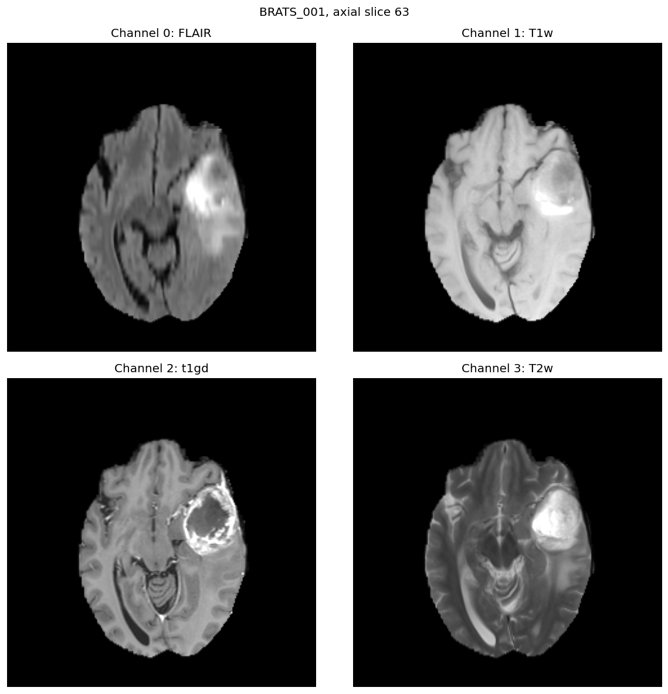
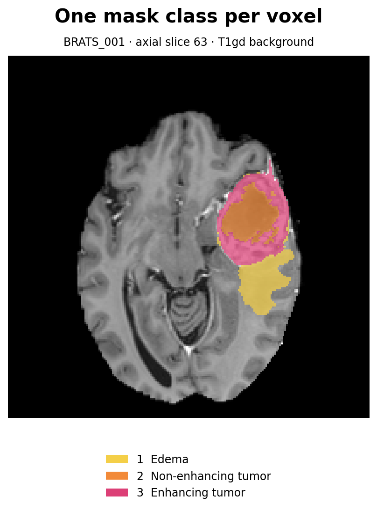
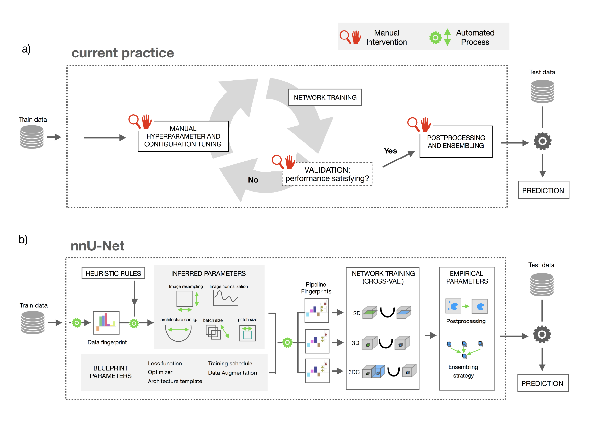
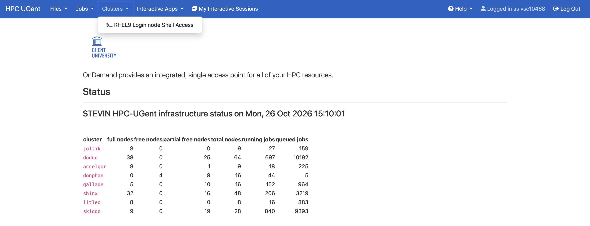
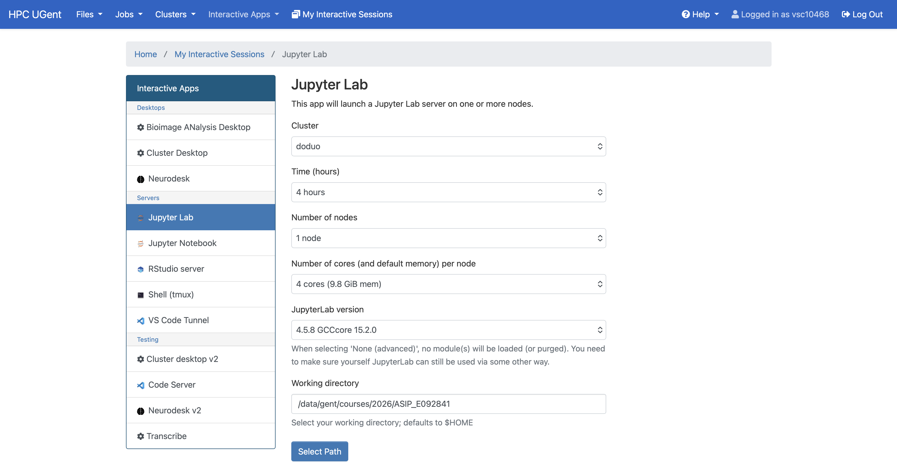

# BraTS lab: five steps toward nnU-Net

## What is BraTS?

BraTS stands for **Brain Tumor Segmentation**. The challenge uses MRI scans of people with brain tumors to study how well computer models can outline tumor subregions. Each patient has several MRI contrasts that show different tissue features. Expert annotations mark where tumor and surrounding edema appear in the 3D scan. Drawing these regions by hand takes time and can vary between readers ([BraTS challenge](https://www.med.upenn.edu/cbica/brats2021/), [benchmark paper](https://pmc.ncbi.nlm.nih.gov/articles/PMC4833122/)).

In this lab, the clinical problem is **locating the tumor and its parts in a patient's MRI**. Your model learns to assign one class to each voxel: background, edema, non-enhancing tumor, or enhancing tumor. You will compare its output with annotated masks from patients held out of training. The sample data is the BraTS-based [Medical Segmentation Decathlon Task01 BrainTumour](https://medicaldecathlon.com/) dataset. Its four MRI channels are FLAIR, T1w, T1gd, and T2w; its mask values are `0`, `1`, `2`, and `3` in the class order above.

### What the images and labels look like

The four MRI channels show the **same axial slice** of one patient. Each contrast makes different tissue features easier to see:



The matching label map assigns one class to each voxel. Here, the colors show the three tumor classes over the T1gd image; uncolored tissue is background (`0`):



*Both BraTS figures use patient BRATS_001, axial slice 63, from the [Medical Segmentation Decathlon Task01 BrainTumour dataset](https://medicaldecathlon.com/) (CC BY-SA 4.0).*

## Why nnU-Net?

U-Net became a standard starting point for medical image segmentation, but a good network alone does not determine the result: image spacing, normalization, patch size, augmentation, loss, training schedule, and inference all matter. Medical datasets differ in scan size, voxel spacing, contrasts, class balance, and available GPU memory, so one hand-picked configuration may transfer poorly. nnU-Net (“no new net”) was proposed in 2019 to make these choices systematically. It reads a **dataset fingerprint** (such as image size, spacing, modalities, and classes), applies shared **blueprint** rules (such as plain U-Net blocks), **infers** choices like patch size and network depth from the data and hardware, and **tests** choices like model configuration on validation data. The [paper added to this repository](docs/1904.08128v2.pdf) was revised in 2020 and the work was [published in *Nature Methods*](https://doi.org/10.1038/s41592-020-01008-z) in 2021. Its strong results across many tasks made nnU-Net a **gold-standard reference** for comparing medical segmentation methods.

The original nnU-Net can configure and train a pipeline out of the box. In this lab, you will **adapt our simple U-Net pipeline by hand**, one group of choices at a time, and measure the change in validation Dice, runtime, and memory. This controlled comparison is an **ablation study**. Our final model will be *nnU-Net-like*; we are learning which design decisions help on this dataset, not reproducing the full automatic system.



*Figure from the [nnU-Net paper](docs/1904.08128v2.pdf): a dataset fingerprint and shared rules guide the pipeline choices.*

**Paper reading:** Read printed pages **16–26** of [Isensee et al.](docs/1904.08128v2.pdf) before the five steps below. The detailed methods are on pp. 16–19 and the design-principle summary is on pp. 24–26. Appendix D (pp. 31–33) gives the augmentation details. The page numbers printed in this PDF match the PDF viewer's page numbers.

## Lab structure and grading

### Schedule and experiment plan

You will build one final model and compare its segmentation performance with the other submissions. You also need to show **how you got there**. Start with the supplied baseline, then test five changes in order: augmentation, architecture, loss, optimizer and batch size, and one idea of your own. Each run builds on the previous one. This is an ablation: it shows what each change contributed. **Do not run a grid search** or change several steps at once to chase a score. Keep the same patient split and training budget so the comparisons mean something.

Most points reward the work and your explanation; the competition score is three points. Plan for about **4 hours of guided work**, plus cluster training time. The times are guides, not deadlines.

**Submission deadline: Monday, 9 November 2026**, two weeks after the lab. Submit your repository or ZIP, the W&B Report PDF, and the live W&B Report link by that date.

| Part | Expected time | Points |
| --- | ---: | ---: |
| Connect to the cluster and set up your group copy | 20 min | 0 |
| Introduction: start the baseline job and explore the notebook | 40 min | 0 |
| 1. Augmentation | 20 min | 2 |
| 2. Architecture | 40 min | 4 |
| 3. Loss and deep supervision | 30 min | 2 |
| 4. Optimizer and batch size | 30 min | 2 |
| 5. Free choice | 30 min | 2 |
| W&B Report and PDF | 30 min | 5 |
| Final training performance | Cluster run | Up to 3 |
| **Total** | **4 h, plus training** | **20** |
| Git commit and push | — | **+1 bonus** |

### What we grade

For steps **1–4**, we inspect your code in the named `YOUR CODE HERE` functions and the model/loss/optimizer templates. We also grade how you explain the **effect you intended** and what actually happened in the W&B learning curves and report. For step **5**, tell us where you implemented your idea in the space below and compare its W&B curve with step 4. The **5 report points** are graded from the submitted `reports/ablation-report.pdf`; include the learning curves and your interpretation there.

For **final training performance**, we use the selected final W&B run's `val/dice_mean` at its **last recorded epoch**. This is epoch 50 for the standard step 5 run, or a later epoch if you do the optional longer final run described in step 5. The metric is the mean Dice across edema, non-enhancing tumor, and enhancing tumor on the shared validation patients. We use this final point, rather than the best checkpoint or best epoch. The best 25% of submissions receive **3 points**; the next 25% receive **2**; the next 25% receive **1**; the last 25% receive **0**.

### One validation split for everyone

The Task01 training set has 484 patients. [`main.py`](main.py) sorts their case names, shuffles them with the fixed validation seed `42`, and uses 20% (97 patients) for validation. Every graded run uses these same patients. The split is also logged to W&B as `split.json`. Keep the full dataset and this split for graded runs; `--max-cases` is only for a quick local check. Taking the last 20% of sorted names would let the names determine the holdout. Full [nnU-Net uses five-fold cross-validation](https://github.com/MIC-DKFZ/nnUNet/blob/master/documentation/how_to_use_nnunet.md); this lab uses one fixed holdout to fit the course training budget.

Submit the **whole updated repository** in one of two ways: push it to your private GitLab project for the **one-point Git bonus**, or upload a ZIP of the repository to **Ufora** for the standard 20 points. Both routes require a PDF of your W&B Report with the main lessons from the ablation. The dataset and online W&B runs stay outside the repository. Your instructors will tell you how to access your private GitLab project if you choose Git. [git.md](docs/git.md) explains the Git route.

## Get access and set up your workspace

### Open the cluster login shell

Sign in to [UGent HPC OnDemand](https://login.hpc.ugent.be/pun/sys/dashboard/) and choose **Clusters → RHEL9 Login node Shell Access**. In that shell, move to your group's personal folder. **Replace `group01` with your own group number**:



```bash
cd /data/gent/courses/2026/ASIP_E092841/groups/group01
```

Run the clone or copy commands below in this shell. The shared input files are also available from here.

### Get your group copy

Work in your group's personal folder under `/data/gent/courses/2026/ASIP_E092841/groups/`, not in the shared `input` folder. Choose one route:

- **Git route:** Set up your cluster SSH key using [git.md](docs/git.md), then replace the example URL with your **own private project's SSH clone URL**:

  ```bash
  git clone git@gitlab.com:COURSE/submissions/YOUR_PROJECT.git nn-unet-lab
  cd nn-unet-lab
  ```

  If you already cloned the project, use `cd nn-unet-lab` followed by `git pull` instead. This route is eligible for the one-point Git bonus when you commit and push your work.

- **Copy route:** Copy the shared `P2_nnUNET_source` folder into your group folder and submit a ZIP through Ufora. It contains the student starter files, without the MRI data or shared environments. Run this once from your group folder, before `nn-unet-lab` exists:

  ```bash
  cp -r /data/gent/courses/2026/ASIP_E092841/input/P2_nnUNET_source nn-unet-lab
  cd nn-unet-lab
  ```

The copy includes hidden starter files such as `.gitignore`. Do not copy over work you have already started. Continue with the commands below from your new `nn-unet-lab` folder.

### Register the notebook kernel and connect W&B

The course provides preinstalled environments in `/data/gent/courses/2026/ASIP_E092841/input/P2_venv/`: `joltik` and `donphan` for GPU work, and `doduo` for the CPU notebook. The extracted [Task01 dataset](https://msd-for-monai.s3-us-west-2.amazonaws.com/Task01_BrainTumour.tar) is at `/data/gent/courses/2026/ASIP_E092841/input/P2_nnUnet_data/Task01_BrainTumour`. The [AWS listing](https://registry.opendata.aws/msd/) records the dataset license. These shared resources stay outside your repository; do not install packages into the shared environments.

Create **your own [W&B account](https://wandb.ai/login), project, and personal API key**. Create the key in [W&B user settings](https://wandb.ai/settings) and create a project under **My projects** ([W&B project guide](https://docs.wandb.ai/guides/hosting/iam/access-management/restricted-projects/)). From your `nn-unet-lab` folder in the RHEL9 login shell, run both setup scripts before starting JupyterLab:

```bash
bash register-notebook-kernel.sh
bash setup-wandb.sh
```

The first script registers **ASIP P2 (doduo CPU)** in your personal Jupyter kernels. It copies only a kernel definition; Python stays in the shared environment. The second asks for your W&B project name and opens W&B's hidden API-key prompt. W&B saves your login in your home directory, where your cluster jobs can use it. The project name is saved in Git-ignored `.wandb-project` and read by `jobs/submission.sh`. Use one project for all runs. You only need to register the kernel once per student account; run W&B setup again if you switch projects or accounts.

### Launch JupyterLab on doduo

Return to the [OnDemand dashboard](https://login.hpc.ugent.be/pun/sys/dashboard/) and open **JupyterLab** under **Interactive Apps**. Request these settings:



| Setting | Value |
| --- | --- |
| Cluster / node type | `doduo` |
| Duration | **4 hours** |
| Nodes | **1** |
| CPU cores | **4** |
| Working directory | `/data/gent/courses/2026/ASIP_E092841` |

Submit the interactive application, wait until it is running, and select **Connect to JupyterLab**. In the file browser, open `groups`, your group folder, and `nn-unet-lab`. Open `README.md` in **Markdown Preview** to read these instructions in rendered form. Open `Explore_BraTS.ipynb` and select **ASIP P2 (doduo CPU)** as its kernel. Because you registered the kernel before launching JupyterLab, no restart is needed.

Use **JupyterLab on doduo to edit code and explore the CPU notebook**. **doduo has no access to the Slurm queue.** Do not run `sbatch`, `squeue`, `srun`, or `scancel` in the JupyterLab terminal.

For all Slurm commands, open **Clusters → RHEL9 Login node Shell Access** from the OnDemand dashboard in a separate browser tab. In that login shell, move to your repository folder (replace `group01`):

```bash
cd /data/gent/courses/2026/ASIP_E092841/groups/group01/nn-unet-lab
```

Keep both tabs open: save your code edits in JupyterLab, then use the **RHEL9 login shell** to submit and monitor jobs or attach to an interactive GPU job. Both use the same shared group folder, so saved edits are available immediately. Training runs on the GPU resources allocated by Slurm. If you edit and commit files in GitLab's web editor instead, run `git pull` in your cluster repository from the login shell before submitting a job.

## Submit the baseline job

Submit the baseline from **Clusters → RHEL9 Login node Shell Access** **before running the notebook** so it trains in the cluster queue while you explore the pipeline on doduo. Check that the login shell is in your `nn-unet-lab` folder first.

### Which job script to use

| Script | When | What it does |
| --- | --- | --- |
| [`jobs/interactive.sh`](jobs/interactive.sh) | During the 27 October lab | Reserves one joltik GPU under `ASIP_1` for a shell you attach to with `srun`. |
| [`jobs/interactive-donphan.sh`](jobs/interactive-donphan.sh) | Outside the lab | Starts a debug shell on donphan, whose A2 GPU is shared. |
| [`jobs/submission.sh`](jobs/submission.sh) | Full training runs | Trains on joltik through the regular queue, using the shared data and environment. |

The **27 October 2026, 13:00–18:00** reservation allows **one reservation job per group**. Use that job for `jobs/interactive.sh`. It already contains `#SBATCH --reservation=ASIP_1`; do not add the reservation to `jobs/submission.sh`. Submit full runs through the regular queue, including during the lab.

To start the reserved interactive job from **Clusters → RHEL9 Login node Shell Access**, first `cd` into your group repository, then run:

```bash
module swap cluster/joltik
JOB_ID=$(sbatch --parsable jobs/interactive.sh)
squeue -j "$JOB_ID"  # wait for RUNNING
srun --jobid="$JOB_ID" --overlap --pty bash -l
```

Inside the joltik shell, load the matching module and shared environment:

```bash
module load PyTorch/2.7.1-foss-2024a-CUDA-12.6.0
source /data/gent/courses/2026/ASIP_E092841/input/P2_venv/joltik/bin/activate
export DATA_ROOT=/data/gent/courses/2026/ASIP_E092841/input/P2_nnUnet_data/Task01_BrainTumour
python main.py --smoke-test
```

Exit the shell when finished, then release the allocation with `scancel "$JOB_ID"`. The reserved script requests two hours; use `sbatch --time=HH:MM:SS jobs/interactive.sh` to request less when the reservation is close to 18:00. Outside the lab, select donphan and submit `jobs/interactive-donphan.sh` with the same `sbatch`/`srun` pattern. Inside that shell, load the same PyTorch module and activate `/data/gent/courses/2026/ASIP_E092841/input/P2_venv/donphan`.

If you launch a W&B run manually inside either interactive shell, pass your saved project name with `--wandb-project "$(<.wandb-project)"`. Your W&B login is already available there.

For the baseline or a full comparison run, use the **RHEL9 login shell**, move to your repository root, and submit to the regular joltik queue:

```bash
module swap cluster/joltik
sbatch jobs/submission.sh
squeue -u "$USER"
```

`sbatch` prints a job ID; Slurm writes `slurm-<job-id>.out` in the submission directory. The script loads joltik's PyTorch module, activates `P2_venv/joltik`, reads your saved W&B project name, and trains on the shared dataset. Set `RUN_NAME`, `MODEL`, `LOSS`, `OPTIMIZER`, `PATCH_SIZE`, `BATCH_SIZE`, or `LEARNING_RATE` before later submissions. Its default is 50 epochs; step 5 explains how to request an optional longer run.

The loader uses the Task01 mask values directly. Use the Task01 data for this starter lab if another BraTS copy has a different label convention.

For a quick check without data or W&B, run `python main.py --smoke-test`. For a short pipeline check, set `DATA_ROOT` to the shared dataset path above and use `python main.py --data-root "$DATA_ROOT" --max-cases 2 --epochs 1 --patches-per-case 1 --val-interval 1 --base-channels 4 --wandb-mode offline`. These checks do not replace the full baseline job.

## Explore the pipeline while it trains

In [Explore_BraTS.ipynb](Explore_BraTS.ipynb), use the **ASIP P2 (doduo CPU)** kernel you selected during setup and run the cells in order. The kernel loads the doduo PyTorch module, activates `P2_venv/doduo`, and points `DATA_ROOT` to the shared Task01 directory. For a local copy, set `DATA_ROOT` to your extracted `Task01_BrainTumour` directory.

The pipeline connects four parts:

| Part | What it does | Where to look |
| --- | --- | --- |
| Data loading | Reads MRI images and tumor masks, then makes training patches | `src/data_loader.py` |
| Model architecture | Turns a four-channel MRI into four class logits per voxel | `src/model.py` |
| Loss | Compares the class logits with the one-channel integer mask | `src/loss.py` |
| Optimization | Uses loss gradients to update the model's weights | `src/optim.py` |

[`main.py`](main.py) imports these parts, joins them in a training loop, validates on full images, and logs the results to W&B. Follow one batch through these four parts in the notebook before starting the five changes below.

1. **Data loading:** Find one patient with `glob`, inspect MONAI's training and validation transforms, and use the validation `DataLoader` to view MRI slices with a whole-tumor overlay. Change `slice_index` and `channel_index` in the plot cell and rerun it to inspect other slices and contrasts.
2. **Model:** Feed one training patch through `BasicUNet`; inspect its three resolution levels and compare input, intermediate, output, and target shapes.
3. **Loss and optimizer:** Compute one loss, backpropagate, and update the weights once. `main.py` repeats these steps over many batches and epochs.

The model emits **logits** shaped `[batch, 4, D, H, W]`, one score for each class. The target has shape `[batch, 1, D, H, W]` and stores one class number per voxel. Cross entropy compares the scores with that number; `argmax` chooses the predicted class.

## Five steps toward nnU-Net

Keep the baseline run. Then make the changes **in order**, giving each run a new `RUN_NAME` (`01-augmentation`, `02-architecture`, and so on) before submitting `jobs/submission.sh` again. Compare each run with the previous one. Keep the patient split, seed, 50-epoch budget, and validation cases fixed through step 4; record per-class Dice, training time, peak GPU memory, and a strong and weak validation image. Update the relevant `*_CONFIG` dictionary in `src/` so W&B records what changed. Run `python main.py --smoke-test` with the matching `--model` and `--loss` choices after each code edit. Step 5 explains how to compare an optional longer run. Treat each change as a planned experiment, not a grid search.

The starter files keep `BasicUNet`, `segmentation_loss`, and `build_optimizer` intact. They also contain separate `NNUNet`, `nnunet_loss`, and `build_nnunet_optimizer` templates. [`main.py`](main.py) selects them using the options below; `jobs/submission.sh` passes the matching environment variables. Keep each choice from the previous step unless the table changes it.

| Run | `MODEL` | `LOSS` | `OPTIMIZER` |
| --- | --- | --- | --- |
| Baseline and step 1 | `basic` | `baseline` | `adam` |
| Step 2 | `nnunet` | `baseline` | `adam` |
| Step 3 | `nnunet` | `nnunet` | `adam` |
| Steps 4–5 | `nnunet` | `nnunet` | `nnunet` |

### 1. Augmentation — change what the model sees

**Paper:** p. 17 (overview), p. 24 (why it matters), and Appendix D, pp. 31–33 (details). nnU-Net augments patches during training. Its spatial changes are **rotation, scaling, and mirroring**; its image-intensity changes are **Gaussian noise, Gaussian blur, brightness, contrast, simulated low resolution, and gamma**. These are applied with probabilities, producing new variations of a patch on each visit.

**Your task:** Fill the `YOUR CODE HERE` lines in `advanced_train_transforms` in [`src/data_loader.py`](src/data_loader.py). Add at least **two spatial changes** (for example a flip and rotation or scaling) to both `image` and `label`, plus **two intensity changes** (for example Gaussian noise and contrast) to `image` only. MONAI dictionary transforms such as `RandFlipd`, `RandAffined`, and `RandGaussianNoised` fit the existing `Compose`. If a spatial transform interpolates the mask, use **nearest-neighbor** interpolation so labels remain `0,1,2,3` (for `RandAffined`, `mode=("bilinear", "nearest")` with `keys=["image", "label"]`). Keep MONAI's `RandCropByPosNegLabeld` sampler and leave `val_transforms` free of random augmentation. Show one augmented image and its matching mask. The paper also uses z-score MRI normalization and foreground oversampling; leave our baseline normalization and sampler fixed here so this run tests augmentation alone.

### 2. Architecture — give the U-Net more capacity and context

**Paper:** pp. 16 and 18, plus pp. 24–25. The paper's plain U-Net uses **two convolution blocks at each encoder and decoder resolution**. Each block is `Conv3d → InstanceNorm3d → LeakyReLU` (negative slope `0.01`). A stride-2 convolution enters the next lower resolution; a transposed convolution upsamples in the decoder. Feature channels start at 32 in the paper and usually double after each downsampling, capped at 320 in its 3D model. Our baseline instead has one convolution per stage, max pooling, interpolation, and no normalization.

**Your task:** Leave `BasicUNet` unchanged. Build the new `NNUNetBlock` in [`src/model.py`](src/model.py) from the paper's two-block description on pp. 16 and 24. The comments explain which layers belong in it and how the first convolution moves the image to a smaller resolution. `NNUNet.__init__` already creates the encoder, decoder, upsampling layers, and four-class output head. Make its depth depend on the patch size as described below. Then complete `NNUNet.forward` by following the path in `BasicUNet`: save features on the way down, join them to features of the same size on the way up, and produce the full-size prediction. The starter comments give hints without filling in the forward pass. Use just one output for now; intermediate predictions belong to step 3. Once it works, run `python main.py --smoke-test --model nnunet`, then submit with `MODEL=nnunet` and `LOSS=baseline`.

**How deep should it be?** The paper stops downsampling when another step would make a feature map smaller than **4 voxels** on an axis (pp. 18 and 25). In our simpler model, every downsampling halves all three patch sides. If those sides are `P₁, P₂, P₃`, the largest number of downsampling steps is `k = minᵢ floor(log₂(Pᵢ / 4))`. There are `k + 1` resolution levels. Work this out in `NNUNet.__init__` from the given `patch_size`, instead of using the placeholder depth. For example, a 32 × 32 × 32 patch goes through `32 → 16 → 8 → 4`, so `k=3`; a 64 × 64 × 64 patch gives `k=4`. Choose patch sides divisible by `2ᵏ` so the encoder and decoder sizes match. The paper notes that this two-block design gives `5k + 2` convolutional layers, excluding the class heads (p. 25). Full nnU-Net also uses voxel spacing and GPU memory; this exercise uses patch size only.

### 3. Loss and deep supervision — train intermediate predictions too

**Paper:** pp. 16–17 and 25. nnU-Net combines **Dice loss and cross entropy**. Dice rewards overlap and helps with small tumor classes; cross entropy supplies a voxel-wise classification signal. The paper averages the two terms. It also adds *deep supervision*: decoder outputs at eligible intermediate resolutions get their own segmentation heads and losses. Lower-resolution losses receive smaller weights, halved each level and normalized to sum to one.

**Your task:** This is the **first step that adds multiple output levels**. In `NNUNet` in [`src/model.py`](src/model.py), add an auxiliary four-class head for the half-resolution decoder feature map. Complete the `return_aux=True` branch so training returns `(full_logits, half_logits)`; ordinary `model(image)` must still return only full-resolution logits for sliding-window validation. [`main.py`](main.py) already requests auxiliary outputs when `LOSS=nnunet`. Write `nnunet_loss` yourself in [`src/loss.py`](src/loss.py). MONAI's `DiceCELoss(to_onehot_y=True, softmax=True, lambda_dice=0.5, lambda_ce=0.5)` combines the two terms for our integer mask. Apply it at both output resolutions, resize the target for the half-resolution output using **nearest-neighbor** interpolation, then combine the two losses with weights `1` and `1/2`, divided by `1.5`. The paper excludes its two lowest resolutions from deep supervision; for deeper 64³ patches it also supervises another intermediate level, while our lab implements **one** auxiliary level. Check both output shapes and backpropagation with `python main.py --smoke-test --model nnunet --loss nnunet`, then submit with `MODEL=nnunet` and `LOSS=nnunet`.

### 4. Optimizer and batch size — use the paper's training rule

**Paper:** pp. 16–19 and 24–26. The paper uses **SGD with Nesterov momentum `0.99`**, initial learning rate `0.01`, and a polynomial learning-rate decay: `lr(epoch) = 0.01 × (1 − epoch / total_epochs)^0.9`. It favors a large patch that still permits at least **two samples per optimizer step**, then increases batch size if memory remains. Its full schedule is 1000 epochs of 250 minibatches each; the lab keeps its shorter fixed budget so runs remain comparable.

**Your task:** Leave baseline `build_optimizer` alone. Write `build_nnunet_optimizer` yourself in [`src/optim.py`](src/optim.py): create SGD with Nesterov momentum `0.99` and a per-epoch polynomial scheduler using `torch.optim.lr_scheduler.LambdaLR`, then return both. [`main.py`](main.py) already calls `scheduler.step()` after each epoch. First compare the optimizer alone: set `OPTIMIZER=nnunet` and `LEARNING_RATE=0.01`, while keeping the previous patch size and batch size **2**.

Then make a **separate patch-size/batch-size run following the paper's memory rule**. Choose the largest spatial patch that still fits **at least two samples per optimizer step** on your GPU; only increase the batch size above two if memory remains after choosing the patch. A larger patch gives more image context but uses memory that could otherwise hold more samples. Set `PATCH_SIZE` as three comma-separated dimensions and set `BATCH_SIZE` before submitting `jobs/submission.sh`. The script keeps `patches_per_case=1`, so its effective batch size is `BATCH_SIZE`. Keep the model, loss, optimizer, split, and 50-epoch budget fixed while comparing your chosen configuration with the optimizer-only run. Check that your patch dimensions work with the depth rule from step 2. Report the two patch/batch configurations, why you chose the final pair, their peak GPU memory, runtime, and validation Dice. Do not reduce the effective batch below two to fit a larger patch.

### 5. Your choice — test one more nnU-Net idea

Choose **one** change motivated by the paper. State what you expect it to change, implement it, and compare it with step 4 on the same validation patients. Explain the relevant paper rule, the code or training setting you changed, and what the W&B curves show. Give this run a distinct name such as `05-free-choice`.

**A longer run is allowed.** You can make training duration your step 5 change by keeping the step 4 model and settings fixed and setting `EPOCHS` above 50. Compare its result at epoch 50 with step 4, then report what happens by its last epoch. If you choose a different step 5 change, run it for 50 epochs first for a matched comparison; you may then repeat that same configuration for more epochs as an additional final run. `jobs/submission.sh` starts every run from epoch 1; it does **not** resume a checkpoint. Give the longer run its own `RUN_NAME`, for example `05-longer`, and submit it to the regular joltik queue with enough wall time, such as:

```bash
EPOCHS=100 RUN_NAME=05-longer sbatch --time=24:00:00 jobs/submission.sh
```

Keep the validation split and seed fixed. Include the 50-epoch comparison and the longer run's final validation result, runtime, and GPU memory in your report. State clearly which W&B run is your final performance submission; its **last recorded** `val/dice_mean` is used for the competition score.

**Step 5 hand-in note — fill this in before submitting:**

- Idea and expected effect: _your answer_
- File(s) and function(s) changed: _your answer_
- Where we should look in the code: _your answer_
- Step 5 W&B run name or link: _your answer_
- Longer-run W&B link and final run choice, if applicable: _your answer_

## W&B Report and submission

The submission is due **Monday, 9 November 2026**.

Write a clear W&B Report that links the **baseline and all five steps in order**, including the separate patch-size/batch-size comparison and any optional longer run. Include learning curves for training loss and validation Dice, a table of final per-class Dice, runtime, and peak GPU memory for each run, and one strong and one weak validation image. For each step, state what you changed, what you expected from the paper, what happened, and how you interpret the difference. Discuss the free-choice experiment in the same way. A result that fails to improve Dice is still useful when you explain it. End with the final model you chose and its limits. The report and its PDF are worth **5 points**.

Submit the **whole updated repository**. It should contain your completed loader, model, loss, optimizer, notebook or notes you changed, and `jobs/submission.sh`. Save a readable PDF copy of your W&B Report at `reports/ablation-report.pdf` in the repository. The PDF must contain the learning curves, results, and **key insights from each of the five ablations** so a reader can understand your findings without opening W&B. Submit your live W&B Report link as well. We grade the report from the **PDF**, so make sure its figures and text are readable without opening W&B.

Keep the BraTS images and masks outside the repository. Your W&B runs and interactive report live in your W&B project; exclude local `wandb/` logs and `runs/` checkpoints from **both** Git and the ZIP. Keep your API key out of `jobs/submission.sh` and every other repository file. `.wandb-project` contains only your project name and is ignored by Git.

**Git route (+1 point):** Make at least **one commit and one push** to your private GitLab project, then submit its URL. You may work directly on `main`; a branch or merge request is not required. We encourage a commit after each experiment so you can recover earlier work and see how your pipeline changed. Read [git.md](docs/git.md) for the commands.

**Ufora route (no Git bonus):** Upload one ZIP of the entire updated repository to Ufora. Include `reports/ablation-report.pdf` and submit the live W&B Report link through the course submission form. You receive the same base grade of up to 20 points.

Read the paper's **pp. 16–26** for the reasoning behind these choices; this README is an implementation guide, not a substitute for those pages.
